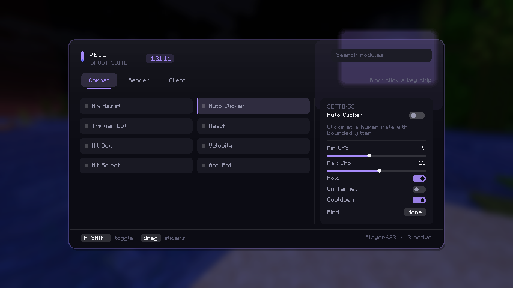

# Veil

A quiet, premium ghost client for **Minecraft 1.21.11** (Fabric, client-side only).

Veil stays inside the ghost envelope: no flight, no killaura, no packet teleports. Everything it
does is camera, click and interaction tuning that a good player can do by hand.



## Build

Requires JDK 21. The Gradle wrapper is not committed, so use a local Gradle 9.2+:

```bash
gradle build
```

Output: `build/libs/veil-1.0.0.jar` — drop it in `.minecraft/mods` with Fabric Loader 0.19.5+
and Fabric API 0.141.6+1.21.11.

## Usage

| Key | Action |
| --- | --- |
| `R-SHIFT` | open / close the menu |
| click a key chip on a module card | rebind that module |

Click a module card to toggle it, pick it with the settings panel, drag sliders, scroll the
settings column. Click the search field and type to filter the current category. Everything
persists to `config/veil.json`.

## Modules

**Combat**

| Module | What it does |
| --- | --- |
| Aim Assist | GCD-snapped, human-bounded camera correction with FOV/range/priority control, visible-only and click-only modes |
| Auto Clicker | CPS range with bounded jitter, hold/on-target/cooldown gates |
| Trigger Bot | fires on crosshair contact with a randomised reaction delay |
| Reach | interaction range through vanilla attributes (3.0-6.0 entity, 4.5-7.0 block) |
| Hit Box | client-side target box scaling |
| Velocity | knockback reduction with horizontal/vertical split and probability |
| Hit Select | W-tap / sprint reset / keep sprint on hit |
| Anti Bot | UUID, tab-list and ping decoy filtering shared by every target list |

**Render**

Watermark, Array List, Target HUD (health, distance, ping, angle), Info chips (CPS/FPS/ping).

**Client**

Appearance — six accent palettes that animate across the gui and hud.

## Layout

```
src/main/java/dev/veil/
├── Veil.java              bootstrap, tick loop, keybinds, click fan-out
├── core/                  module system, settings, config, targeting, rotation, stats
├── modules/combat/        aim, click, trigger, reach, hitbox, velocity, hit select, antibot
├── modules/render/        hud modules
├── modules/client/        appearance
├── gui/                   theme, 2d primitives, click gui, hud router
└── mixin/                 hud frame, attack, velocity packet, hitbox, doAttack accessor
```

## Notes

- Client-side only. Servers still validate movement and reach; Veil keeps its values inside
  ranges that pass vanilla checks, but nothing here guarantees a given server accepts them.
- Config is plain JSON, additive, and tolerant of missing keys.
